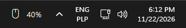

# batteryChecker

A tiny Windows app that shows your wireless mouse's battery level right on the taskbar, next to the system tray, styled to blend in with the built-in Windows 11 icons.



## Features

- Mouse icon + battery percentage on the taskbar, next to the tray
- Matches the taskbar color and highlights on hover, just like the system icons
- Turns red when the battery is low (20% or less) and shows `+` while charging
- Hides automatically when a fullscreen app or game is running
- Right-click menu: device name, **Refresh**, **Quit**
- No SteelSeries GG needed: it talks to the mouse's receiver directly over USB HID

## Supported devices

| Device | Connection | Status |
|---|---|---|
| SteelSeries Aerox 3 Wireless | 2.4 GHz receiver | ✅ Tested |

Bluetooth mode and other mice are not supported yet. See [Adding a device](#adding-a-device) if you'd like to help.

## Requirements

- Windows 11 (Windows 10 may work, but hasn't been tested)
- For running from source: Python 3.10+

## Download

Grab `batteryChecker.exe` from the [Releases](../../releases) page and run it.

The exe isn't code-signed, so Windows SmartScreen may warn you the first time you run it. Click **More info → Run anyway**, or build it yourself from source.

### Start with Windows

1. Press `Win + R`, type `shell:startup` and press Enter.
2. Put a shortcut to `batteryChecker.exe` in the folder that opens.

## Run from source

```powershell
git clone <this repository>
cd batteryChecker
python -m venv .venv
.venv\Scripts\Activate.ps1
python -m pip install -r requirements.txt
python main.py
```

## Build the exe

```powershell
python -m pip install pyinstaller
.\build.bat
```

The result is `dist\batteryChecker.exe`.

## How it works

- **Reading the battery:** the app finds the SteelSeries receiver with [hidapi](https://github.com/trezor/cython-hidapi), sends the battery-level command (`0xD2`) to its vendor-specific HID interface and decodes the reply. The highest bit means "charging", and the rest is the level in 5% steps.
- **Showing it:** Windows 11 has no public API for adding items to the taskbar, so the widget is a small borderless, always-on-top window placed just left of the tray. It's owned by the taskbar window, so it stays above it, and it samples the taskbar's color so it blends in.

```
battery_checker/
├── models.py              # DeviceStatus dataclass
├── providers/
│   ├── base.py            # Provider interface: scan() -> list[DeviceStatus]
│   └── steelseries.py     # SteelSeries receiver over HID
└── taskbar_widget.py      # the taskbar widget (tkinter + WinAPI)
```

## Adding a device

Each type of device is a **provider**: a class with a `scan()` method that returns a list of `DeviceStatus(name, level, charging)`. To support another mouse:

1. Find its USB product ID (run `hid.enumerate(0x1038)` in Python).
2. Look up its battery command in [rivalcfg's device profiles](https://github.com/flozz/rivalcfg/tree/master/rivalcfg/devices), in the `battery_level` section.
3. Add it to the SteelSeries provider, or write a new provider for another brand.

Pull requests are welcome. Please mention which device you tested on.

## Credits

- [rivalcfg](https://github.com/flozz/rivalcfg) by flozz, for documenting the SteelSeries HID protocol
- [hidapi](https://github.com/trezor/cython-hidapi), for USB HID access from Python

This project isn't affiliated with or endorsed by SteelSeries.
